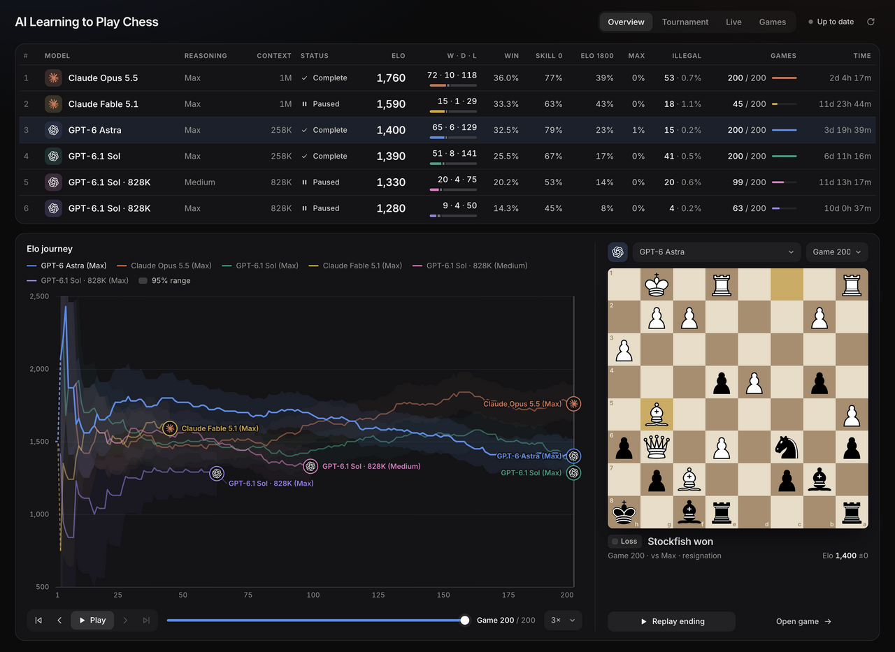
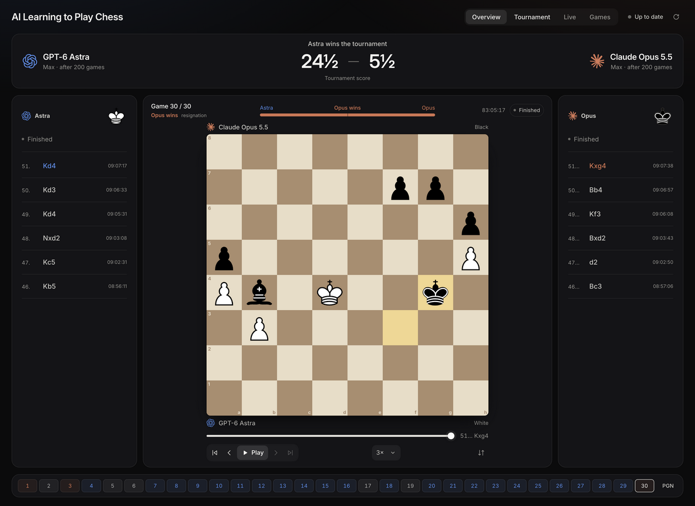

# Models Learning Chess

Six language-model runs learning chess through their own notes, practice, and games against fixed Stockfish opponents. The models’ weights were not trained or changed.

**[View the deployed dashboard →](https://ailearningchess.ai-learning-chess.workers.dev/)**



The dataset includes **807 scored benchmark games**, **30 head-to-head games**, **367 practice sessions**, **two unfinished benchmarks**, and **1,324 saved workspace snapshots**. Losses, illegal moves, and stopped drills are included.

[Conversation and tool logs](data/traces/) contain **551,684 exported records across eight traces**, including messages, tool calls and results, usage, and recorded thinking text where available. Game ledgers and learner notes are included too.

| Folder | Contents |
|---|---|
| [data/](data/) | Games, moves, PGNs, learning notes, snapshots, and exported conversation/tool logs |
| [harness/](harness/) | Experiment instructions, configuration, and our chess referee scripts |
| [provenance/](provenance/) | Original instructions, code revisions, settings audits, and redaction records |
| [analysis/](analysis/) | Existing analysis scripts and reports |
| [website/](website/) | A frozen copy of the dashboard and custom hosting source |

**Start with [data/games.csv](data/games.csv)** for a spreadsheet, or [data/index.json](data/index.json) for an overview. [DATA.md](DATA.md) explains the formats.

To check the data:

```sh
python3 tools/verify_dataset.py
```

To repeat the experiment with another model, create an empty run and open your own agent in that folder:

```sh
python3 harness/new_run.py --model YOUR_MODEL --output runs/my-model
```

Tell the agent to read `AGENTS.md` and `GOAL.md`. It chooses its learning methods and plays through `./play`. See [harness/README.md](harness/README.md) for the setup. Claude Code, Codex, account files, and native session-resume files are not bundled.



Screenshots were captured from the deployed site on 15 October 2026. Elo is a provisional engine-relative estimate, not a calibrated human rating. Recorded reasoning text is included where available; it does not establish access to complete internal reasoning.

Data is released under [CC0](DATA_LICENSE); project code under [GPLv3](LICENSE). Existing third-party notices are retained in [NOTICE.md](NOTICE.md).
